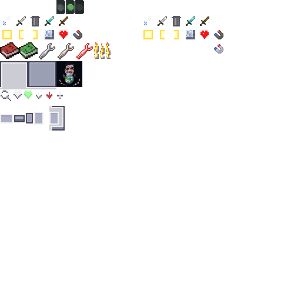
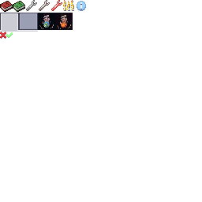
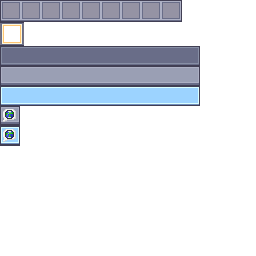

# Modernity-GTNH-UI — NEI 贴图来源与图集坐标

## 来源、归属和许可

- 归属：**Modernity-GTNH-UI 项目及其贡献者**（见[项目贡献者](https://github.com/ModernityGTNH/Modernity-GTNH-UI/graphs/contributors)）。本目录的 10 个 PNG 是 [ModernityGTNH/Modernity-GTNH-UI 的 `29x` 分支](https://github.com/ModernityGTNH/Modernity-GTNH-UI/tree/29x)在提交 [`10b9e676c2cb45ac5cee2c1df3285bf085ad53f6`](https://github.com/ModernityGTNH/Modernity-GTNH-UI/tree/10b9e676c2cb45ac5cee2c1df3285bf085ad53f6)的原件。只平铺目录路径，没有裁剪、重绘、调色、压缩或转换；逐文件比对上游 Git blob ID。
- 已检查本地 Modernity-GTNH 主包 `29x`（`213c5c10734673fc9a9d072dbc349eb7032d18fc`），没有 `assets/nei`。其 [README 的 UI resourcepacks 一节](https://github.com/ModernityGTNH/Modernity-GTNH/blob/213c5c10734673fc9a9d072dbc349eb7032d18fc/README.md#ui-resourcepacks)链接上述独立 UI。检查了本地已知候选目录，未发现独立 UI 包，因此从官方同分支取得原件。不是从 Dark UI 或 NEI 的默认美术提取。
- 已随附该提交发行的[原始许可证全文](LICENSE.txt)（[上游同文件](https://github.com/ModernityGTNH/Modernity-GTNH-UI/blob/10b9e676c2cb45ac5cee2c1df3285bf085ad53f6/LICENSE.txt)），明示 **[CC BY-NC-SA 4.0 International](https://creativecommons.org/licenses/by-nc-sa/4.0/)**。[同提交 README](https://github.com/ModernityGTNH/Modernity-GTNH-UI/blob/10b9e676c2cb45ac5cee2c1df3285bf085ad53f6/README.md#licensing)的旧徽章仍链到 3.0；此处按明确的许可证全文记录，并保留这一不一致。未发现 UI 仓库为下列文件提供单独许可证声明；这不代表对第三方权利、商标、商业使用或再分发有额外授权。
- **当前只作本机非商业使用，不随此 mod 对外分发。** 如另有分享需求，应先向上游确认旧徽章冲突与相关权利，并遵守适用的署名、非商业及改编材料相同方式共享要求。本目录的许可说明不是给本 mod 其他文件重新授权。

## 原件清单

| 本地原件 | 上游资源路径 | PNG 尺寸 | Git blob SHA-1 |
|---|---|---:|---|
| [nei_sprites.png](nei_sprites.png) | `assets/nei/textures/nei_sprites.png` | 512×512 | `f2bafb0e2d0b500803fe4d4cd08a92c9751ab3c5` |
| [nei_tabbed_sprites.png](nei_tabbed_sprites.png) | `assets/nei/textures/nei_tabbed_sprites.png` | 256×256 | `d6fcf66eeea0b3e7e494f77e028b49565edd3df8` |
| [recipebg.png](recipebg.png) | `assets/nei/textures/gui/recipebg.png` | 256×256 | `248a84f2a9dcb00dd6692d0642f7aa5a0eeba549` |
| [widgets.png](widgets.png) | `assets/minecraft/textures/gui/widgets.png` | 256×256 | `70b604335dc15097b60b570a25e9ecfb0297a357` |
| [catalyst_tab.png](catalyst_tab.png) | `assets/nei/textures/catalyst_tab.png` | 36×36 | `55f4b55ef67068779ce2f80192b3593ff9ef5641` |
| [slot.png](slot.png) | `assets/nei/textures/slot.png` | 18×18 | `988dacea7d273e02a7accea006f9aa7865182b83` |
| [dash.png](dash.png) | `assets/nei/textures/dash.png` | 3×1 | `459d122cbb71bea46ae0d3a27d4b261c61324ef1` |
| [inv.png](inv.png) | `assets/nei/textures/gui/inv.png` | 256×256 | `79409f8ab061ffc745c46718de22287a8932ede5` |
| [potion.png](potion.png) | `assets/nei/textures/gui/potion.png` | 256×256 | `ed3fd01d946f299a4f828974ecfb47f7495547a4` |
| [repair.png](repair.png) | `assets/nei/textures/gui/repair.png` | 168×36 | `d882213667284d08ab89e5d3699f9f1466d3c463` |

`widgets.png` 虽不是 `nei` 命名空间，但原版 NEI 的通用按钮确实引用它。独立 UI 的 `assets/nei/textures/items/cheat_speical.png` 属于物品贴图，不是 GUI，本目录未引入；其他模组的 NEI 配方处理器素材也未引入。

## 可直接映射的原版 NEI 区域

坐标约定为从左上起的 **`(x, y, 宽, 高)`**。Java 引用来自 [GTNewHorizons/NotEnoughItems `6b7e465306810ad11d2413214077237798be13a7`](https://github.com/GTNewHorizons/NotEnoughItems/tree/6b7e465306810ad11d2413214077237798be13a7/src/main/java/codechicken/nei)（与本地 NEI fork 核验提交相同）。

### `nei_sprites.png`：512×512 实际像素，Java 按 256×256 UV

[LayoutManager `drawIcon`](https://github.com/GTNewHorizons/NotEnoughItems/blob/6b7e465306810ad11d2413214077237798be13a7/src/main/java/codechicken/nei/LayoutManager.java#L886-L895)绑定 `nei:textures/nei_sprites.png`。[DrawableBuilder 默认纹理尺寸](https://github.com/GTNewHorizons/NotEnoughItems/blob/6b7e465306810ad11d2413214077237798be13a7/src/main/java/codechicken/nei/drawable/DrawableBuilder.java#L5-L13)为 256×256；以物理像素裁选此 PNG 时，四个值都乘 2。若想复原原版逻辑尺寸，源矩形倍增但显示尺寸不倍增。

| 真实用途 | Java UV 区域 | PNG 像素区域 | Java 定位 |
|---|---|---|---|
| 配方搜索开关（放大镜） | `(0,76,10,10)` | `(0,152,20,20)` | [GuiRecipe:495](https://github.com/GTNewHorizons/NotEnoughItems/blob/6b7e465306810ad11d2413214077237798be13a7/src/main/java/codechicken/nei/recipe/GuiRecipe.java#L493-L500) |
| 配方收藏关 / 开（双色心） | `(10,76,9,10)` / `(19,76,9,10)` | `(20,152,18,20)` / `(38,152,18,20)` | [GuiFavoriteButton:37–48](https://github.com/GTNewHorizons/NotEnoughItems/blob/6b7e465306810ad11d2413214077237798be13a7/src/main/java/codechicken/nei/recipe/GuiFavoriteButton.java#L37-L48) |
| 配方填充 / 缺料 / 叠加（3 种加号） | `(28,76,9,10)` / `(37,76,9,10)` / `(46,76,9,10)` | `(56,152,18,20)` / `(74,152,18,20)` / `(92,152,18,20)` | [GuiOverlayButton:90–107](https://github.com/GTNewHorizons/NotEnoughItems/blob/6b7e465306810ad11d2413214077237798be13a7/src/main/java/codechicken/nei/recipe/GuiOverlayButton.java#L90-L107) |
| 删除（垃圾桶） | `(144,12,12,12)` | `(288,24,24,24)` | [LayoutStyleMinecraft:28–39](https://github.com/GTNewHorizons/NotEnoughItems/blob/6b7e465306810ad11d2413214077237798be13a7/src/main/java/codechicken/nei/LayoutStyleMinecraft.java#L28-L39) |
| 配方窗滚动轨道 / 滑块 | `(42,90,13,21)` / `(22,96,6,9)` | `(84,180,26,42)` / `(44,192,12,18)` | [GuiRecipe:86–92](https://github.com/GTNewHorizons/NotEnoughItems/blob/6b7e465306810ad11d2413214077237798be13a7/src/main/java/codechicken/nei/recipe/GuiRecipe.java#L86-L92) |
| 默认竖滚动轨道 / 滑块 | `(29,95,8,11)` / `(22,96,6,9)` | `(58,190,16,22)` / `(44,192,12,18)` | [ScrollBar:62–67](https://github.com/GTNewHorizons/NotEnoughItems/blob/6b7e465306810ad11d2413214077237798be13a7/src/main/java/codechicken/nei/scroll/ScrollBar.java#L62-L67) |
| 默认横滚动轨道 / 滑块 | `(0,97,11,8)` / `(12,98,9,6)` | `(0,194,22,16)` / `(24,196,18,12)` | [ScrollBar:70–76](https://github.com/GTNewHorizons/NotEnoughItems/blob/6b7e465306810ad11d2413214077237798be13a7/src/main/java/codechicken/nei/scroll/ScrollBar.java#L70-L76) |

### `nei_tabbed_sprites.png`：256×256，Java 与 PNG 像素 1:1

| 真实用途 | PNG 像素区域 | Java 定位 |
|---|---|---|
| 书签面板关 / 开（红书、绿书） | `(0,0,16,16)` / `(16,0,16,16)` | [LayoutManager:485–495](https://github.com/GTNewHorizons/NotEnoughItems/blob/6b7e465306810ad11d2413214077237798be13a7/src/main/java/codechicken/nei/LayoutManager.java#L485-L495)、[LayoutStyleMinecraft:81](https://github.com/GTNewHorizons/NotEnoughItems/blob/6b7e465306810ad11d2413214077237798be13a7/src/main/java/codechicken/nei/LayoutStyleMinecraft.java#L81) |
| 选项普通 / 工具 / 作弊模式（扳手） | `(32,0,16,16)` / `(48,0,16,16)` / `(64,0,16,16)` | [LayoutManager:428–435](https://github.com/GTNewHorizons/NotEnoughItems/blob/6b7e465306810ad11d2413214077237798be13a7/src/main/java/codechicken/nei/LayoutManager.java#L428-L435) |
| 燃料 / 信息处理器图标 | `(80,0,14,14)` / `(96,0,16,16)` | [IMCForNEI:106–132](https://github.com/GTNewHorizons/NotEnoughItems/blob/6b7e465306810ad11d2413214077237798be13a7/src/main/java/codechicken/nei/IMCForNEI.java#L106-L132) |
| 配方分类标签选中 / 未选中 | `(0,16,24,24)` / `(24,16,24,24)` | [GuiRecipeTab:47–60](https://github.com/GTNewHorizons/NotEnoughItems/blob/6b7e465306810ad11d2413214077237798be13a7/src/main/java/codechicken/nei/recipe/GuiRecipeTab.java#L47-L60) |
| 叠加模式材料缺少 / 已有标记（叉、勾） | `(0,40,8,8)` / `(8,40,8,8)` | [GuiOverlayButton:32–39](https://github.com/GTNewHorizons/NotEnoughItems/blob/6b7e465306810ad11d2413214077237798be13a7/src/main/java/codechicken/nei/recipe/GuiOverlayButton.java#L32-L39) |

### 独立背景与按钮

| 真实用途 | PNG 像素区域 | Java 定位 |
|---|---|---|
| `recipebg.png`：配方窗、配方提示框 | `(0,0,184,174)`；四边 9 px 九宫切片（源含 4 px 外缘） | [GuiRecipe:68–81](https://github.com/GTNewHorizons/NotEnoughItems/blob/6b7e465306810ad11d2413214077237798be13a7/src/main/java/codechicken/nei/recipe/GuiRecipe.java#L68-L81)、[RecipeTooltipLineHandler:21–34](https://github.com/GTNewHorizons/NotEnoughItems/blob/6b7e465306810ad11d2413214077237798be13a7/src/main/java/codechicken/nei/recipe/RecipeTooltipLineHandler.java#L21-L34) |
| `widgets.png`：禁用 / 普通 / 悬停（也用于激活态） | `(0,46,200,20)` / `(0,66,200,20)` / `(0,86,200,20)`；`GuiNEIButton` 四边各 2 px 九宫切片 | [GuiNEIButton:15–20](https://github.com/GTNewHorizons/NotEnoughItems/blob/6b7e465306810ad11d2413214077237798be13a7/src/main/java/codechicken/nei/GuiNEIButton.java#L15-L20)、[LayoutStyleMinecraft:228–248](https://github.com/GTNewHorizons/NotEnoughItems/blob/6b7e465306810ad11d2413214077237798be13a7/src/main/java/codechicken/nei/LayoutStyleMinecraft.java#L228-L248)、[LayoutManager:899–941](https://github.com/GTNewHorizons/NotEnoughItems/blob/6b7e465306810ad11d2413214077237798be13a7/src/main/java/codechicken/nei/LayoutManager.java#L899-L941) |
| `catalyst_tab.png` / `slot.png`：催化物面板及槽位 | 全图 `(0,0,36,36)`／`(0,0,18,18)`，四边 10 px／1 px 九宫切片 | [GuiRecipeCatalyst:50–68](https://github.com/GTNewHorizons/NotEnoughItems/blob/6b7e465306810ad11d2413214077237798be13a7/src/main/java/codechicken/nei/recipe/GuiRecipeCatalyst.java#L50-L68) |
| `inv.png`：NEI 扩展创造物品栏背景（也供 NEI 面板设置预览） | `(0,0,199,204)` | [GuiExtendedCreativeInv:27–34](https://github.com/GTNewHorizons/NotEnoughItems/blob/6b7e465306810ad11d2413214077237798be13a7/src/main/java/codechicken/nei/GuiExtendedCreativeInv.java#L27-L34)、[GuiPanelSettings:264–269](https://github.com/GTNewHorizons/NotEnoughItems/blob/6b7e465306810ad11d2413214077237798be13a7/src/main/java/codechicken/nei/config/GuiPanelSettings.java#L264-L269) |
| `potion.png`：药水编辑器背景 | 从 `(0,0)` 按 GUI 宽高绘制；可见像素范围为 176×207 | [GuiPotionCreator:287–290](https://github.com/GTNewHorizons/NotEnoughItems/blob/6b7e465306810ad11d2413214077237798be13a7/src/main/java/codechicken/nei/GuiPotionCreator.java#L287-L290) |
| `repair.png`：修理配方背景 | 全图 `(0,0,168,36)` | [RepairRecipeHandler:26–29](https://github.com/GTNewHorizons/NotEnoughItems/blob/6b7e465306810ad11d2413214077237798be13a7/src/main/java/codechicken/nei/recipe/RepairRecipeHandler.java#L26-L29) |
| `dash.png`：子面板虚线分割 | PNG 全图 `(0,0,3,1)`；Java 使用逻辑纹理 `(0,0,6,1)` | [AbstractSubpanel:21](https://github.com/GTNewHorizons/NotEnoughItems/blob/6b7e465306810ad11d2413214077237798be13a7/src/main/java/codechicken/nei/AbstractSubpanel.java#L21) |

**不是独立贴图的例子：** Java 里的前后翻页用 `<` / `>` 文本加按钮背景，并没有用箭头 sprite（[PanelWidget:46–65](https://github.com/GTNewHorizons/NotEnoughItems/blob/6b7e465306810ad11d2413214077237798be13a7/src/main/java/codechicken/nei/PanelWidget.java#L46-L65)、[GuiRecipe:303–331](https://github.com/GTNewHorizons/NotEnoughItems/blob/6b7e465306810ad11d2413214077237798be13a7/src/main/java/codechicken/nei/recipe/GuiRecipe.java#L303-L331)）；搜索输入框边框和填充是 [FormattedTextField:160–179](https://github.com/GTNewHorizons/NotEnoughItems/blob/6b7e465306810ad11d2413214077237798be13a7/src/main/java/codechicken/nei/FormattedTextField.java#L160-L179)画的矩形；通用网格的悬停高亮也是 [ItemsGrid:168–171](https://github.com/GTNewHorizons/NotEnoughItems/blob/6b7e465306810ad11d2413214077237798be13a7/src/main/java/codechicken/nei/ItemsGrid.java#L168-L171)程序绘制。以上坐标不虚构额外的按下态、输入框、翻页箭头或高亮 sprite。

## 原图预览

下列预览直接链接本地原始 PNG，不新增预览衍生图。

